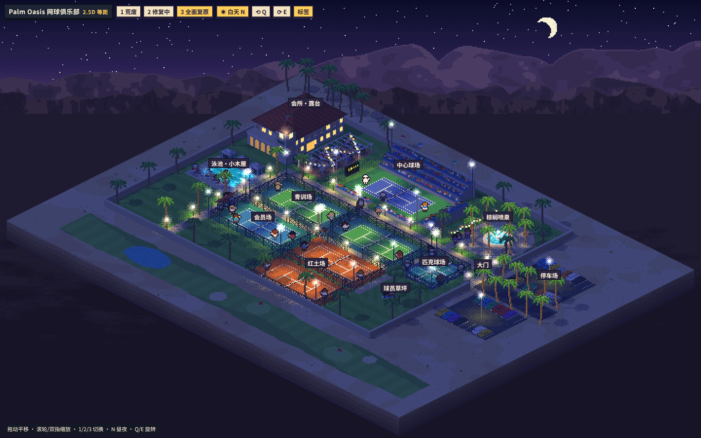

# 美术素材库

画风样片、参考图和美术方向的记录。这里的东西**不进游戏构建**，是给人看、给美术任务当参考的。

## 画风样片（style-demos）

每个样片都是一个独立的 HTML 文件，直接用浏览器打开就能看，不用构建。都用同一张 Palm Oasis 布局（`packages/render/src/scenes/indian-wells/layout.ts` 的世界坐标），有三个复原阶段和昼夜。

| 目录 | 画风 | 状态 |
| --- | --- | --- |
| [isometric-2.5d/](style-demos/isometric-2.5d/) | 2.5D 等距像素：固定 2:1 等距视角，Q/E 平滑旋转 90°，纯 Canvas 2D 软件光栅，无素材无库 | 2026-11-02 用户看过，目前最喜欢的方向；还没定案 |

操作：`1/2/3` 切荒废、修复中、全面复原，`N` 昼夜，`Q/E` 旋转，`L` 标签，拖动平移，滚轮或双指缩放。也可以用 URL 参数直接打开某个状态，例如 `index.html?lv=3&night=1&ang=45`。

每个目录里：
- `index.html`：样片本身
- `notes.md`：怎么实现的、优缺点、手机可读性、上线成本估算、和现有代码的关系、风险
- `shots/`：桌面截图（1440×900）和一张手机截图（390×844）

